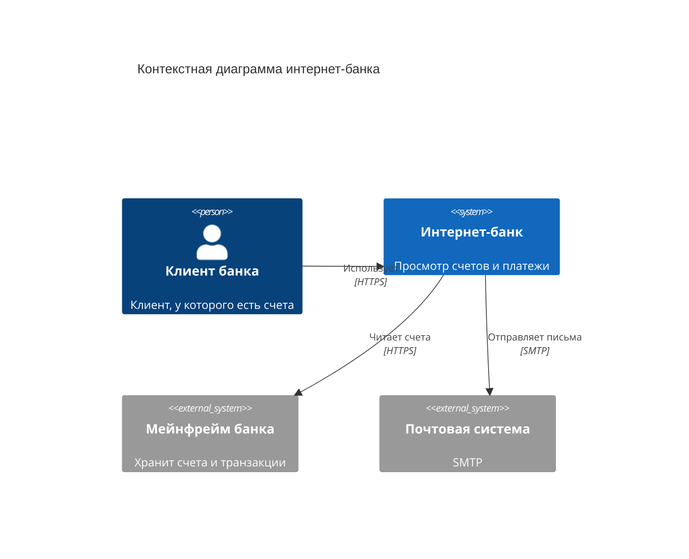
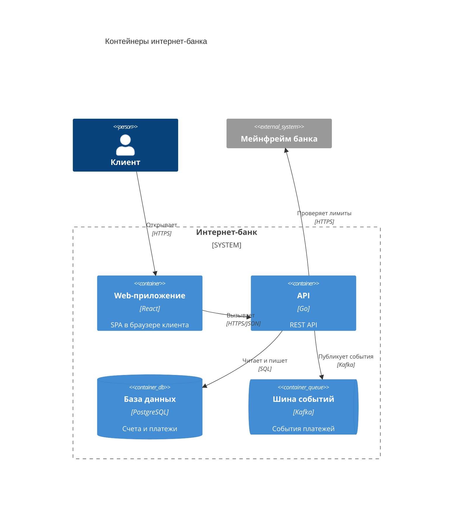
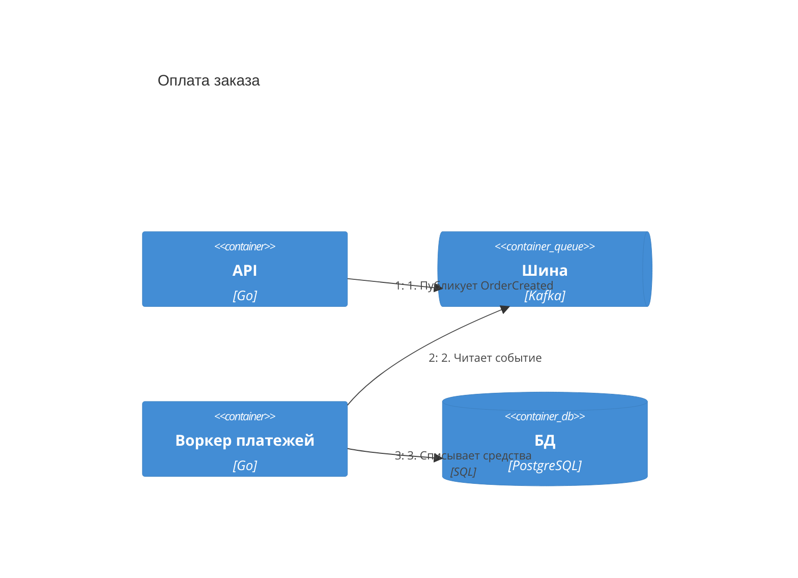

# Mermaid C4 — синтаксис и грабли

Рендерится нативно в GitHub/GitLab Markdown, wiki, статических генераторах.
Статус: experimental — синтаксис может меняться между версиями Mermaid.
Типы: `C4Context`, `C4Container`, `C4Component`, `C4Dynamic`, `C4Deployment`.

## Контекстная диаграмма (L1)

## Контейнерная диаграмма (L2)

## Справочник конструкций

- Люди: `Person(alias, "Имя", "Описание")`, внешний: `Person_Ext`
- Системы: `System`, `System_Ext` (внешняя), `SystemDb`, `SystemQueue`
- Контейнеры: `Container(alias, "Имя", "Технология", "Описание")`, `ContainerDb`, `ContainerQueue`; внешний: `Container_Ext`
- Компоненты: `Component`, `ComponentDb`, `Component_Ext`
- Границы: `System_Boundary(alias, "Имя") { ... }`, `Container_Boundary`, `Enterprise_Boundary`
- Связи: `Rel(a, b, "Действие", "Протокол")`; обратная: `BiRel`; варианты: `Rel_U/Rel_D/Rel_L/Rel_R` (направление для раскладки)
- Стили: `UpdateElementStyle(alias, $bgColor="...")`, `UpdateRelStyle(...)`
- Раскладка: `UpdateLayoutConfig($c4ShapeInRow="3", $c4BoundaryInRow="1")`

## Грабли

1. **Нет маршрутизации стрелок.** Mermaid ставит блоки сеткой в порядке объявления, стрелки идут сквозь блоки. Меняй порядок объявления и `Rel_L/Rel_R`/`Rel_U/Rel_D` для управления.
2. **`UpdateLayoutConfig` почти не помогает** на плотных диаграммах — перейди на PlantUML, если раскладка нечитаема.
3. **L3 (Component) с вложенными границами глючит** — fallback: обычный `flowchart` с `subgraph` для границ (теряется словарь C4, но рендер стабилен).
4. Стрелка с опечаткой в alias → ошибка рендера (это хорошо: опечатки видны).
5. Проверка без браузера: `mmdc -i diagram.mmd -o diagram.svg` (Mermaid CLI).

## Динамическая диаграмма (сценарий)

